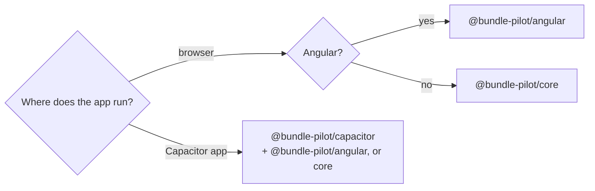
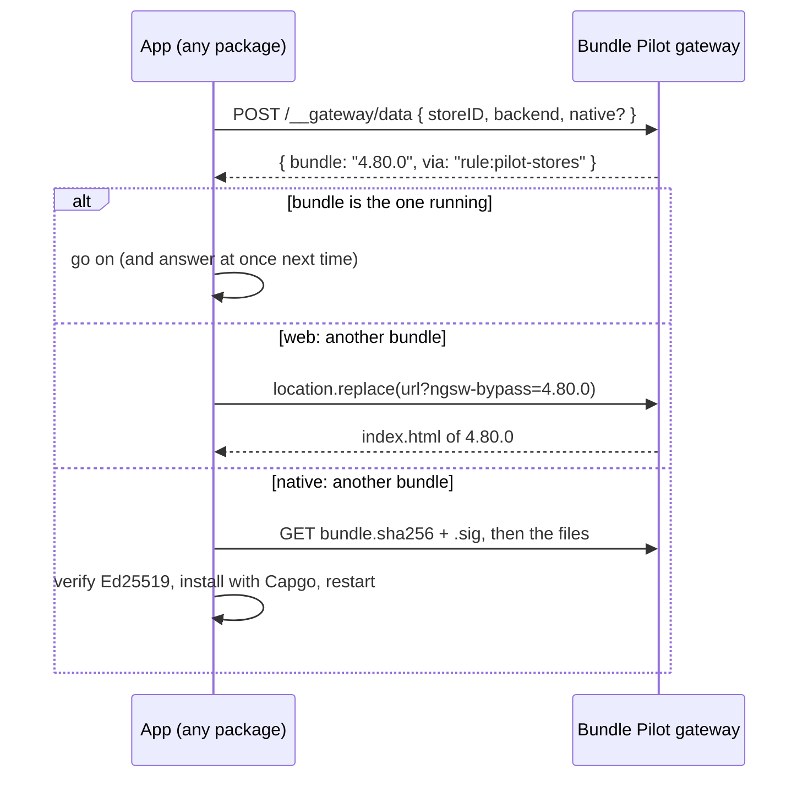

<p align="center">
  
</p>

<h1 align="center">Bundle Pilot SDK</h1>

<p align="center">
  Client packages that run each visitor on the frontend bundle the <a href="../README.md">Bundle Pilot</a> gateway picks,<br>
  on the web and in native apps.
</p>

<p align="center">
  <a href="https://www.npmjs.com/package/@bundle-pilot/core"></a>
  <a href="https://www.npmjs.com/package/@bundle-pilot/angular"></a>
  <a href="https://www.npmjs.com/package/@bundle-pilot/capacitor"></a>
  
</p>

---

## Packages

| Package | For | Size (min+gzip) |
|---|---|---|
| [`@bundle-pilot/angular`](angular/README.md) | Angular 18 to 22: one `provideBundlePilot()` guards every route | 0.5 kB + core |
| [`@bundle-pilot/core`](core/README.md) | Any framework or none: `createPilot().check(facts)` | 1.1 kB, no dependencies |
| [`@bundle-pilot/capacitor`](capacitor/README.md) | Capacitor 8 apps: signed over-the-air updates with Capgo | 1.9 kB + core |

### Which one do I need?



- **An Angular web app:** `@bundle-pilot/angular`. That is one provider and nothing else.
- **React, Vue, Svelte or plain JavaScript:** `@bundle-pilot/core`. Call `check`
  from your router's guard or hook.
- **A Capacitor app:** `@bundle-pilot/capacitor`. With Angular, pass its pilot
  to `provideBundlePilot`, so the web build and the native app share the same code.

## In 30 seconds

```ts
// Angular, web
provideBundlePilot({
  facts: () => {
    const store = inject(StoreService);
    return store.id ? { storeID: store.id, backend: store.posVersion } : null;
  },
});
```

```ts
// Angular, Capacitor: the same provider, with the over-the-air pilot
provideBundlePilot({
  facts,
  pilot: () => createOtaPilot({ gateway: 'https://ota.example.com', publicKey, version }),
});
```

```ts
// Any framework
const pilot = createPilot();
router.beforeEach((to) => pilot.check(currentFacts(), router.resolve(to).href));
```

## How it fits together



Your app sends facts, and the gateway's rules decide. You pilot a build with
some stores, raise a percentage, or back out of a release from the admin UI,
with no new deploy of the app.

## Versioning

All packages are released together with the gateway, from one `vX.Y.Z` tag, so
`@bundle-pilot/*` 1.4.0 goes with gateway 1.4.0. The `0.0.0` in each
`package.json` is a placeholder that the release replaces: don't bump it by hand.

## Development

```sh
pnpm install
pnpm build   # tsc, every package (core first)
pnpm test    # node --test
```

Each package's README is the page npm shows. Keep its links and images
absolute.
